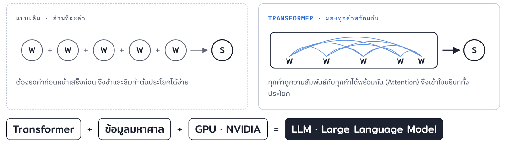
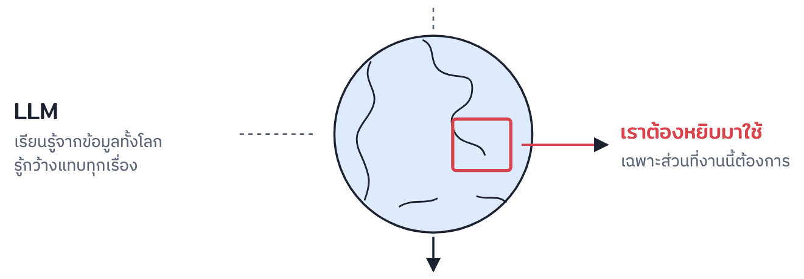
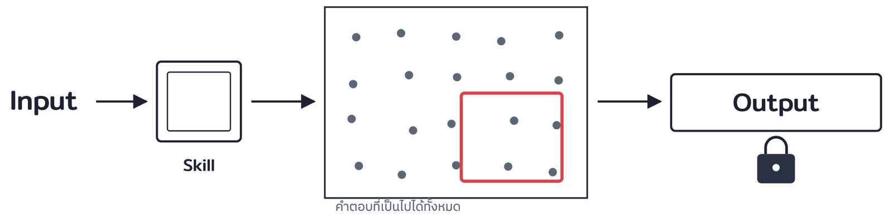
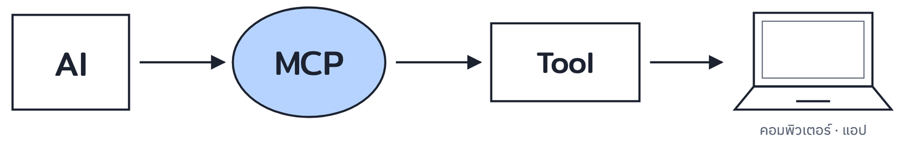

# การจัดการความรู้ยุคดิจิทัล: การประยุกต์ใช้ Generative AI เพื่อสร้างสรรค์คอนเทนต์และสื่อการสอน

Repo นี้รวบรวมไฟล์และตัวอย่างที่ใช้ประกอบการบรรยายหัวข้อ
**“การจัดการความรู้ยุคดิจิทัล: การประยุกต์ใช้ Generative AI เพื่อสร้างสรรค์คอนเทนต์และสื่อการสอน”**

## รายละเอียดการบรรยาย

| | |
|---|---|
| **วันที่** | 27 พฤศจิกายน 2569 |
| **เวลา** | 08.30–16.30 น. |
| **สถานที่** | ห้องประชุม 16/203 คณะเทคโนโลยีสารสนเทศ |
| **วิทยากร** | อ.วันฉัตร พูขุนทด |

## เนื้อหาบรรยาย

### แผนที่ AI ฉบับหน้าเดียว: ตั้งแต่โมเดลถึงเครื่องมือ

รู้ว่ามีโมเดลอะไรบ้าง โมเดลทำงานอย่างไร และจะใช้ Skill กับ MCP ต่อยอดให้ AI ทำงานได้จริงอย่างไร

> **เส้นทาง:** ① โมเดลมีใครบ้าง → ② ชนิดของโมเดล → ③ Flow → ④ เปิดกล่องดำ → ⑤ Skill → ⑥ MCP

#### 1 · Model Landscape: ใครเป็นใคร

| | Closed Model · โมเดลปิด | Open Model · โมเดลเปิด |
|---|---|---|
| **คืออะไร** | ของบริษัท ใช้ผ่านแอปหรือ API ดาวน์โหลดตัวโมเดลไม่ได้ | เปิดให้ดาวน์โหลดน้ำหนักโมเดล (weights) ไปรันบนเครื่องตัวเองได้ |
| **ตัวอย่าง** | **Claude**: Opus, Fable<br>**GPT**: SGL, Astra<br>**Gemini**: Aeon, Carbon | Llama (Meta), DeepSeek, Kimi, Qwen |

#### 2 · Model Type: แยกตามสิ่งที่รับเข้า → สร้างออก

| ชนิด | รับเข้า → สร้างออก | ตัวอย่าง |
|---|---|---|
| **LLM · ภาษา** | text → text | Claude, GPT, Gemini |
| **Image / Video** | text → image · video | ภาพ: Nano Banana, GPT Image, Midjourney<br>วิดีโอ: Veo, Sora |
| **Speech / Sound** | เสียง ↔ ข้อความ · เพลง | Whisper (เสียง → ข้อความ)<br>Gemini TTS (ข้อความ → เสียงพูด)<br>Suno (ข้อความ → เพลง) |

#### 3 · Flow: Prompt → Model → Output

เราพิมพ์ Prompt เข้าไป โมเดลประมวลผลข้างในซึ่งเรามองไม่เห็น (กล่องดำ) แล้วส่งคำตอบออกมา ความรู้ในกล่องมาจากข้อมูลมหาศาลทั่วโลกที่ใช้ฝึกโมเดล ส่วนคำตอบมีเครื่องหมาย ? เพราะคาดเดาไม่ได้เต็มร้อย และบางครั้งก็ผิด (hallucination)

<p align="center"><picture>
  <source media="(prefers-color-scheme: dark)" srcset="lecture/ai-map-one-page/figures/flow-dark.png">
  
</picture></p>

#### 4 · เปิดกล่องดำ: Transformer → LLM

ข้างในกล่องคือ **Neural Network** แบบที่เรียกว่า **Transformer** จุดเด่นคือมองทุกคำในประโยคพร้อมกัน (Attention) จึงประมวลผลขนานกันได้ พอทำงานบนชิป GPU ซึ่งคำนวณขนานได้เก่ง ก็สร้างโมเดลขนาดใหญ่มากได้

<p align="center"><picture>
  <source media="(prefers-color-scheme: dark)" srcset="lecture/ai-map-one-page/figures/transformer-dark.png">
  
</picture></p>

<p align="center"><picture>
  <source media="(prefers-color-scheme: dark)" srcset="lecture/ai-map-one-page/figures/llm-bridge-dark.png">
  
</picture></p>

#### 5 · Skill: ล็อกผลลัพธ์ให้คงที่

โดยปกติโมเดลตอบได้หลายแบบ (จุดที่กระจายทั้งกรอบ) **Skill** คือชุดคำสั่งและขั้นตอนที่เตรียมไว้ล่วงหน้า ช่วยบีบให้คำตอบอยู่ในกรอบที่เราต้องการ (กรอบแดง) ผลลัพธ์จึงคงที่และทำซ้ำได้ทุกครั้ง

<p align="center"><picture>
  <source media="(prefers-color-scheme: dark)" srcset="lecture/ai-map-one-page/figures/skill-dark.png">
  
</picture></p>

#### 6 · MCP: Model Context Protocol

MCP คือ "ภาษากลาง" ที่ทำให้ AI สั่งงานเครื่องมือภายนอกได้ เปรียบเหมือน **USB-C ของ AI** ต่อแบบเดียวกันแล้วใช้ได้กับทุกเครื่องมือ AI จึงไม่ได้แค่ตอบคำถาม แต่ลงมือทำงานจริงบนคอมพิวเตอร์และแอปได้

<p align="center"><picture>
  <source media="(prefers-color-scheme: dark)" srcset="lecture/ai-map-one-page/figures/mcp-dark.png">
  
</picture></p>

- **ตัวอย่าง:** AI อ่านไฟล์ใน Google Drive, สร้างงานใน Figma, ส่งข้อความใน Slack ผ่าน MCP ของแต่ละเครื่องมือ

> **สรุป:** เลือกโมเดลให้ตรงงาน · เข้าใจว่าข้างในคือ Transformer · ใช้ Skill คุมผลลัพธ์ · ใช้ MCP ให้ AI ลงมือทำ

**ไฟล์ฉบับเต็ม**

| ไฟล์ | รูปแบบ |
|---|---|
| [index.html](lecture/ai-map-one-page/index.html) | หน้าเว็บ (เปิดในเบราว์เซอร์ สลับธีมสว่างและมืดตามเครื่อง) |
| [ai-map-one-page.png](lecture/ai-map-one-page/export/ai-map-one-page.png) / [.pdf](lecture/ai-map-one-page/export/ai-map-one-page.pdf) | ธีมสว่าง |
| [ai-map-one-page-dark.png](lecture/ai-map-one-page/export/ai-map-one-page-dark.png) / [.pdf](lecture/ai-map-one-page/export/ai-map-one-page-dark.pdf) | ธีมมืด |

## Skill ที่ใช้ในการบรรยาย

| Skill | ใช้ทำอะไร | โฟลเดอร์ |
|---|---|---|
| **lecture-clip-production** | ชุดผลิตรายวิชาและคลิปบรรยายออนไลน์: เริ่มวิชาใหม่จากคำอธิบายรายวิชา PLO และ CLO เขียน ตรวจ และส่งออก script คลิปบรรยาย รวมถึง quiz ใบงาน และคู่มือกิจกรรม | [skills/lecture-clip-production](skills/lecture-clip-production) |
| **motion-graphic-dsh-fast** | ปลั๊กอิน Motion graphics สำหรับ DeepSeek Harness: สร้างโมชันกราฟิกจากหัวข้อ ตั้งแต่บทพูด ภาพวาด SVG ดนตรีประกอบ จนถึง composition แบบ HTML ที่ render เป็น MP4 ด้วย HyperFrames มี 3 skill คือ `mg-fast`, `mg-hyperframes` และ `mg-hyperframes-cli` | [skills/motion-graphic-dsh-fast](skills/motion-graphic-dsh-fast) |

วิธีติดตั้งและสิ่งที่ต้องมีในเครื่องของ motion-graphic-dsh-fast ดูที่ [README ของปลั๊กอิน](skills/motion-graphic-dsh-fast/README.md)
ส่วน skill ของ HyperFrames ที่รวมมาในปลั๊กอินเป็นของโครงการ [HyperFrames](https://github.com/heygen-com/hyperframes) (Apache-2.0) ดูรายละเอียดที่ [ATTRIBUTION.md](skills/motion-graphic-dsh-fast/ATTRIBUTION.md)

## Skill ด้าน Motion และ Video ที่นิยมบน GitHub

รวม repo ที่มี Skill (ไฟล์ `SKILL.md`) ให้ AI agent เช่น Claude Code หรือ Codex ใช้ทำงานโมชันและวิดีโอ แต่ละกลุ่มเรียงตามจำนวนดาว

### Motion graphics: สร้างภาพเคลื่อนไหวจากโค้ด

| Repo | ใช้ทำอะไร | ⭐ |
|---|---|---|
| [heygen-com/hyperframes](https://github.com/heygen-com/hyperframes) | เขียนวิดีโอเป็น HTML แล้ว render เป็น MP4 โดย HeyGen (เป็นฐานของ motion-graphic-dsh-fast) | 90.6k |
| [remotion-dev/skills](https://github.com/remotion-dev/skills) | Skill ทางการของ Remotion สำหรับสร้างวิดีโอด้วย React | 8.1k |
| [haidrrrry/claude-remotion-skill](https://github.com/haidrrrry/claude-remotion-skill) | Skill ทำโมชันกราฟิกด้วย Remotion มี B-roll ซับไตเติล และ sound design | 1.4k |

### Video: ตัดต่อและผลิตวิดีโอ

| Repo | ใช้ทำอะไร | ⭐ |
|---|---|---|
| [OpenMontageInc/OpenMontage](https://github.com/OpenMontageInc/OpenMontage) | ระบบผลิตวิดีโอแบบ agentic โอเพนซอร์ส มี 12 pipeline เครื่องมือกว่า 100 ตัว และไฟล์ skill กับความรู้ด้านโปรดักชันกว่า 700 ไฟล์ เปลี่ยน AI coding assistant ให้เป็นสตูดิโอผลิตวิดีโอ (สัญญาอนุญาต AGPL-3.0) | 83.6k |
| [kajisho5/ffmpeg-skill](https://github.com/kajisho5/ffmpeg-skill) | ตัดต่อวิดีโอในเครื่องด้วย FFmpeg 42 เครื่องมือ เช่น ตัด ใส่ซับ ปรับสัดส่วนภาพ ปรับความดังเสียง ส่งออกตามแพลตฟอร์ม มี MCP server ไม่ต้องใช้ cloud | 11.4k |
| [digitalsamba/claude-code-video-toolkit](https://github.com/digitalsamba/claude-code-video-toolkit) | ทำวิดีโอครบขั้นตอนด้วย Claude Code ตั้งแต่บท เสียงพากย์ AI ดนตรี คลิป จนถึง render ด้วยโมเดลโอเพนซอร์ส | 2.8k |
| [heygen-com/skills](https://github.com/heygen-com/skills) | สร้างอวตารและผลิตวิดีโอผ่าน Video Agent ของ HeyGen (ต้องมีบัญชี HeyGen) | 0.6k |

### รวมลิงก์เพิ่มเติม

- [zhuyansen/awesome-claude-video-skills](https://github.com/zhuyansen/awesome-claude-video-skills) (⭐ 2.8k): รายชื่อรวม repo ด้านวิดีโอสำหรับ coding agent 180 repo แยกตามประเภท และให้เกรดความปลอดภัย

จำนวนดาว ณ วันที่ 26 พ.ย. 2569 ก่อนติดตั้ง Skill จากภายนอก ควรเปิดอ่าน `SKILL.md` และสคริปต์ในนั้นก่อนทุกครั้ง

## การดาวน์โหลดไฟล์

```bash
git clone https://github.com/Wanchatpookhuntod/lecture_ai_motion-video.git
```

หรือกดปุ่ม **Code → Download ZIP** บนหน้า GitHub
