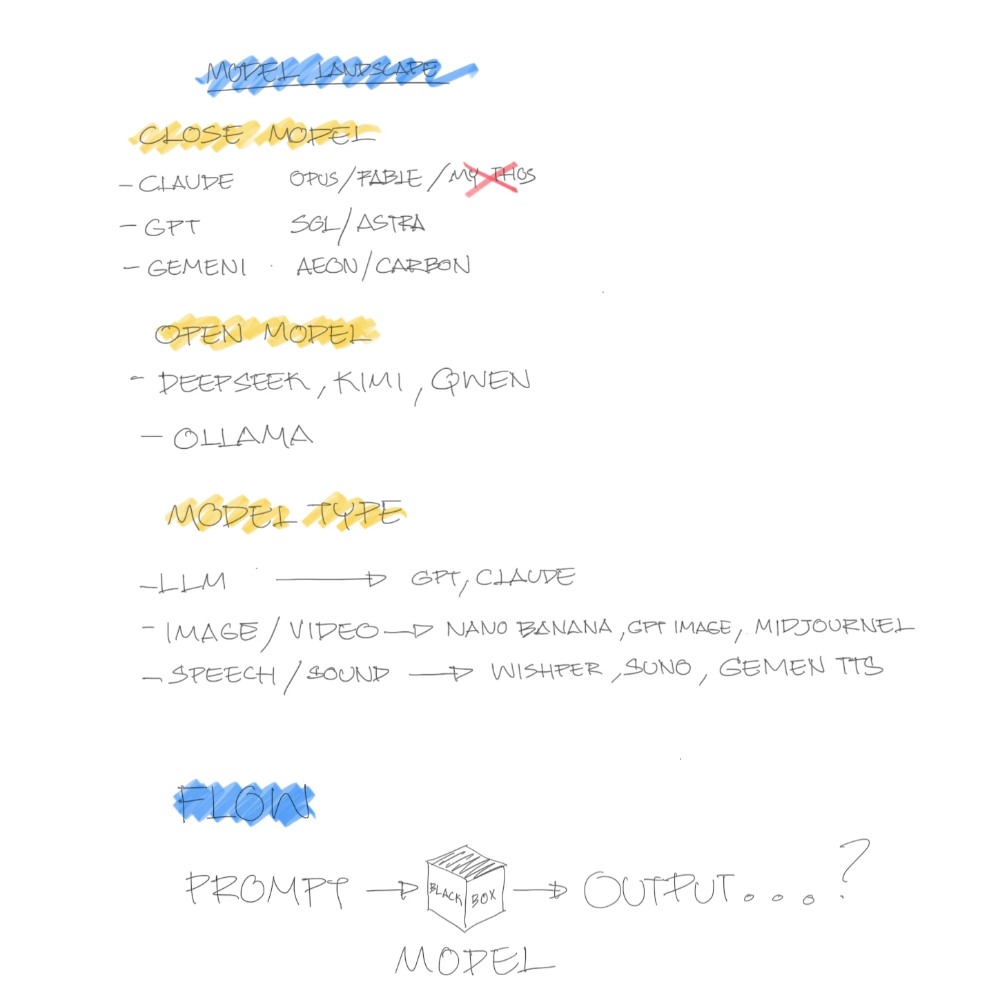
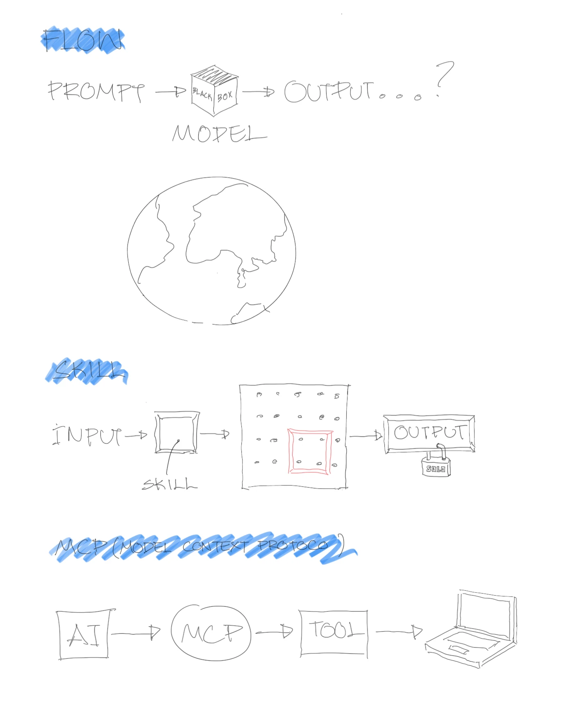
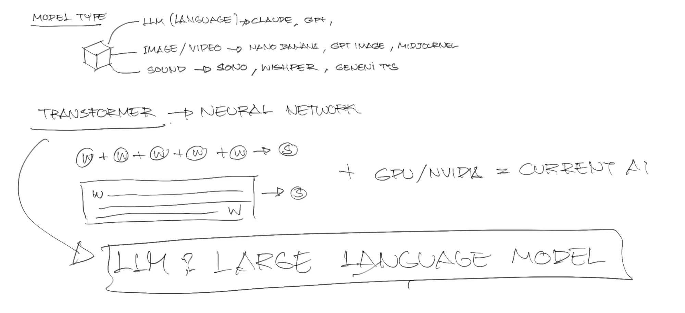

# วิธีสร้างแผนที่ AI ฉบับหน้าเดียว

หน้านี้เล่าขั้นตอนที่ใช้ทำ [แผนที่ AI ฉบับหน้าเดียว](../../README.md#เนื้อหาบรรยาย) จากโน้ตเขียนมือ 3 หน้า จนได้หน้าเว็บ ไฟล์ PNG และ PDF โดยใช้ Claude Code บนแอป Claude (แท็บ Code)

ทั้งหมดทำในบทสนทนาเดียว สั่งงานด้วยภาษาไทยสั้น ๆ ไม่ได้เขียนโค้ดเอง

## ภาพรวม

```text
โน้ตมือ 3 หน้า → ให้ AI อ่านและวิเคราะห์ → สั่งทำ one page → แก้ทีละจุด → export PNG/PDF
```

| ขั้น | สิ่งที่พิมพ์ | ผลที่ได้ |
|---|---|---|
| 1 | แนบรูปโน้ต 3 หน้า แล้วพิมพ์ `อ่าน วิเคราะห์` | ถอดความโน้ต ชี้จุดผิด และเสนอลำดับเนื้อหา |
| 2 | `ทำ one page` | หน้าเว็บหน้าเดียว 6 ส่วน |
| 3 | สั่งแก้ทีละเรื่อง | หน้าเว็บที่ตรงกับที่ต้องการ |
| 4 | `อยากได้ onepage แบบนี้เลย export` | ไฟล์ PNG และ PDF |

## ขั้นที่ 1: เขียนโน้ตมือ แล้วให้ AI อ่านและวิเคราะห์

เริ่มจากร่างเนื้อหาด้วยมือก่อน 3 หน้า มีหัวข้อ Model Landscape, Model Type, Flow, Skill, MCP และ Transformer พร้อมภาพสเก็ตช์ เช่น กล่องดำ รูปโลก กรอบแดง และแม่กุญแจ

โน้ตที่ใช้จริง (กดที่รูปเพื่อดูขนาดเต็ม)

| หน้า 1: Model Landscape, Model Type, Flow | หน้า 2: Flow, รูปโลก, Skill, MCP | หน้า 3: Model Type, Transformer, LLM |
|---|---|---|
| [](notes/note-1.webp) | [](notes/note-2.webp) | [](notes/note-3.webp) |

ถ่ายรูปโน้ตแล้วแนบเข้าแชต พิมพ์สั้น ๆ ว่า

```text
อ่าน วิเคราะห์
```

AI ตอบกลับมา 3 เรื่อง

1. **ถอดความแต่ละส่วน** และตีความภาพสเก็ตช์ เช่น รูปโลกน่าจะหมายถึงข้อมูลจากทั้งโลกที่ใช้ฝึกโมเดล
2. **ชี้จุดที่ควรแก้ก่อนสอน**
   - เนื้อหาคลาดเคลื่อน: Ollama เป็นโปรแกรมรันโมเดล ไม่ใช่ตัวโมเดล และกลุ่ม Image/Video ยังไม่มีตัวอย่างโมเดลวิดีโอ
   - ทิศทางของโมเดลเสียงต่างกัน: Whisper แปลงเสียงเป็นข้อความ ส่วน Gemini TTS แปลงข้อความเป็นเสียง
   - คำสะกด: GEMENI → Gemini, WISHPER → Whisper, SONO → Suno, MIDJOURNEL → Midjourney, NVIDA → NVIDIA
3. **เสนอลำดับใหม่** ให้เรื่อง Transformer มาเป็น "เปิดกล่องดำ" ต่อจาก Flow แทนที่จะอยู่ท้ายสุด

> **เคล็ดลับ:** ให้ AI วิเคราะห์ก่อนสั่งทำ จะได้เห็นว่า AI เข้าใจโน้ตตรงกับที่เราคิดไหม และได้แก้เนื้อหาก่อนลงมือออกแบบ

## ขั้นที่ 2: สั่งทำหน้าเดียว

```text
ทำ one page
```

AI สร้างหน้าเว็บ (HTML) หน้าเดียวตามลำดับที่เสนอ แบ่งเป็น 6 ส่วน ใช้ไฮไลต์สีฟ้ากับเหลืองแบบเดียวกับโน้ตมือ วาดแผนภาพเป็น SVG และรองรับธีมมืด แล้วเผยแพร่เป็นลิงก์ Artifact บน claude.ai ให้เปิดดูได้ทันที

ข้อมูลที่ยืนยันไม่ได้ เช่น ชื่อรุ่นย่อยของโมเดล AI จะใส่ตามโน้ต แล้วเตือนให้ตรวจกับเว็บของบริษัทอีกครั้งก่อนสอน

## ขั้นที่ 3: แก้ทีละจุด

เปิดหน้าที่ได้ดู แล้วสั่งแก้ทีละเรื่อง ตัวอย่างที่ใช้จริง

| สิ่งที่พิมพ์ | สิ่งที่เปลี่ยน |
|---|---|
| ถามก่อนว่า `แล้ว model แบบเปิดของ facebook คืออะไร` แล้วสั่ง `เพิ่ม Llama แทน ollama` | กล่อง Open Model เปลี่ยนเป็น Llama (Meta), DeepSeek, Kimi, Qwen |
| `รูปโลกละ ให้เชื่อ llm กับ skill` | เพิ่มลูกโลกขนาดใหญ่คั่นระหว่างส่วน 4 (LLM) กับส่วน 5 (Skill) |
| `ไม่ใช่` | AI ถามกลับเป็นตัวเลือกว่าต้องการแบบไหน แล้วแก้ตามที่เลือก |
| `ยังไม่ต้องบอกว่าเป็น skill บอกว่าเราต้องหยิบมาใช้เฉพาะส่วนที่งานนี้ต้องการ` พร้อมแนบภาพหน้าจอจุดที่จะแก้ | ข้อความข้างลูกโลกเปลี่ยนเป็น "เราต้องหยิบมาใช้ เฉพาะส่วนที่งานนี้ต้องการ" |

> **เคล็ดลับ:**
> - สั่งแก้ครั้งละเรื่อง จะได้เห็นผลชัดและย้อนกลับง่าย
> - ถ้าอธิบายด้วยคำยาก ให้แคปหน้าจอแล้ววงจุดที่จะแก้ส่งไปด้วย
> - ถ้าผลไม่ตรงใจ บอกว่า "ไม่ใช่" ได้เลย AI จะถามกลับว่าต้องการแบบไหน
> - ถามข้อเท็จจริงก่อนแก้ได้ เช่น ถามว่าโมเดลเปิดของ Meta คืออะไร แล้วค่อยสั่งเพิ่ม

## ขั้นที่ 4: Export เป็น PNG และ PDF

```text
อยากได้ onepage แบบนี้เลย export
```

AI เปิดหน้าเว็บในเบราว์เซอร์แบบไม่มีหน้าจอ (headless browser) แล้วบันทึกเป็น 2 ไฟล์

- **PNG** ขนาด 2200 × 5768 px ใช้ขึ้นจอหรือโพสต์ได้เลย
- **PDF** หน้ายาวหน้าเดียว ตัวอักษรเป็นเวกเตอร์ ซูมแล้วยังคมชัด

จากนั้น AI เปิดดูไฟล์ PNG เองเพื่อตรวจว่าครบทั้ง 6 ส่วนและฟอนต์ไทยแสดงผลถูกต้อง

PDF ที่ได้เป็นหน้ายาว ไม่ใช่ขนาด A4 ถ้าจะพิมพ์ลงกระดาษ ให้สั่งเพิ่มว่าต้องการ A4 หรือ A3

## ไฟล์ที่ได้

| ไฟล์ | ใช้ทำอะไร |
|---|---|
| [index.html](index.html) | หน้าเว็บต้นฉบับ แก้ต่อได้ สลับธีมสว่างและมืดตามเครื่อง |
| [export/ai-map-one-page.png](export/ai-map-one-page.png) / [.pdf](export/ai-map-one-page.pdf) | ธีมสว่าง |
| [export/ai-map-one-page-dark.png](export/ai-map-one-page-dark.png) / [.pdf](export/ai-map-one-page-dark.pdf) | ธีมมืด |
| [figures/](figures) | แผนภาพที่ตัดจากไฟล์ PNG ใช้ประกอบ README |

## ลองทำเอง

1. ร่างเนื้อหาที่จะสอนด้วยมือ 1 ถึง 3 หน้า มีหัวข้อและภาพสเก็ตช์คร่าว ๆ
2. ถ่ายรูปแนบเข้าแชต แล้วพิมพ์ `อ่าน วิเคราะห์`
3. อ่านผลวิเคราะห์ แก้เนื้อหาที่ผิด แล้วพิมพ์ `ทำ one page`
4. เปิดดูผล แล้วสั่งแก้ทีละจุด
5. พิมพ์ `export` เพื่อเอาไฟล์ PNG และ PDF
6. ตรวจข้อเท็จจริงทุกข้อก่อนนำไปสอน โดยเฉพาะชื่อรุ่นโมเดลที่เปลี่ยนเร็ว
